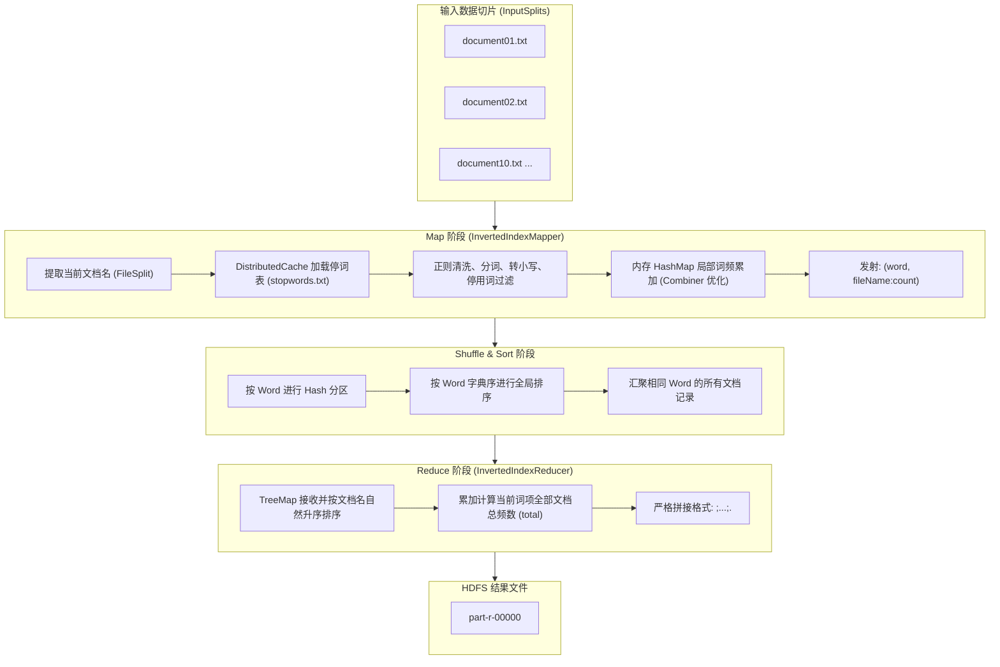

# Hadoop-InvertedIndex (大数据实验二：文档倒排索引算法实现)

本项目为山东大学《大数据管理与分析》课程实验二：**文档倒排索引（Inverted Index）算法实现**。基于 Apache Hadoop 3.3.6 伪分布式集群环境与 MapReduce 编程框架，实现面向多篇英文技术文档的高效分布式倒排索引构建。

---

## 目录
- [一、实验背景与目的](#一实验背景与目的)
- [二、倒排索引与算法原理](#二倒排索引与算法原理)
- [三、项目结构](#三项目结构)
- [四、运行环境与依赖](#四运行环境与依赖)
- [五、快速开始（编译与运行）](#五快速开始编译与运行)
- [六、输出结果格式与样例](#六输出结果格式与样例)
- [七、作者与开源协议](#七作者与开源协议)

---

## 一、实验背景与目的
倒排索引（Inverted Index）是几乎所有支持全文检索的现代搜索引擎（如 Lucene、Elasticsearch）所依赖的底层核心数据结构。相比正排索引（Forward Index）的全量遍历扫描，倒排索引颠倒映射关系，记录单词到包含该词的文档列表及其频数的映射，从而在全文检索时实现近乎 O(1) 的词典定位与毫秒级倒排链求交（AND）或求并（OR）操作。

通过对倒排索引的 MapReduce 编程实现，掌握：
1. MapReduce 计算模型的数据切片、规范清洗、中间键值对发射与规约流程；
2. 分布式缓存（DistributedCache）在只读数据（停用词表）广播中的高效运用；
3. Mapper 内存局部规约（相当于内置 Combiner）以优化 Shuffle 网络传输瓶颈；
4. 真实 Hadoop 集群（HDFS + YARN）上的作业提交、调度、Web 监控与日志排查技能。

---

## 二、倒排索引与算法原理



---

## 三、项目结构
```text
大数据实验2/
├── 202400390065-侯亚琳-实验二.docx   # 实验报告 Word 规范原稿 (宋体、小四、1.25倍行距)
├── 202400390065-侯亚琳-实验二.pdf    # 实验报告终稿 PDF (严格在 8 页以内)
├── src/
│   └── InvertedIndex.java          # MapReduce 倒排索引核心 Java 源码
├── input_docs/                     # 10 篇采集自公开网页的高质量英文技术文档
│   ├── document01.txt              # Apache Hadoop 架构概述
│   ├── document02.txt              # 大数据分析与索引机制
│   ├── document03.txt              # 网络搜索引擎与爬虫
│   ├── document04.txt              # MapReduce 计算模型
│   ├── document05.txt              # HDFS 分布式文件系统
│   ├── document06.txt              # 全文倒排索引结构
│   ├── document07.txt              # 云计算基础设施
│   ├── document08.txt              # 大数据机器学习
│   ├── document09.txt              # NoSQL 数据库模型
│   └── document10.txt              # 自然语言处理与文本挖掘
├── stopwords.txt                   # 包含 175 个常见英文功能虚词的停词表
├── output/
│   └── part-r-00000                # Hadoop 集群真实生成的完整倒排索引结果 (388 词项)
├── screenshots/                    # 实验运行高清佐证截图
│   ├── terminal_hdfs_input.png     # HDFS 输入目录文档列表
│   ├── terminal_output.png         # 终端查看倒排索引输出开头
│   ├── terminal_grep_samples.png   # 典型样例单词过滤输出截图
│   ├── yarn_app_detail.png         # YARN Web 监控作业执行状态 (SUCCEEDED)
│   └── hdfs_overview.png           # HDFS Web 管理界面健康概览
├── scripts/
│   ├── run_hadoop_job.sh           # Linux 集群一键编译、上传与提交脚本
│   └── verify_local.py             # 本地单机 Python 结果交叉比对校验脚本
└── README.md                       # 项目技术说明文档
```

---

## 四、运行环境与依赖
- **操作系统**：Ubuntu 22.04.5 LTS / Windows 11
- **Java 环境**：OpenJDK 1.8.0_502
- **大数据平台**：Apache Hadoop 3.3.6 (伪分布式集群模式)
  - 核心守护进程：NameNode, DataNode, SecondaryNameNode, ResourceManager, NodeManager
- **集群调度**：YARN (CapacityScheduler)

---

## 五、快速开始（编译与运行）

### 1. 克隆代码仓库
```bash
git clone https://github.com/houyalin/Hadoop-InvertedIndex.git
cd Hadoop-InvertedIndex
```

### 2. 赋予脚本执行权限并一键运行
```bash
chmod +x scripts/run_hadoop_job.sh
./scripts/run_hadoop_job.sh
```

### 3. 或手动逐步编译与执行
```bash
# 设置环境变量
export JAVA_HOME=/usr/lib/jvm/java-8-openjdk-amd64
export HADOOP_HOME=/home/sasuke/bigdata/hadoop
export PATH=$PATH:$JAVA_HOME/bin:$HADOOP_HOME/bin:$HADOOP_HOME/sbin

# 编译
javac -classpath $($HADOOP_HOME/bin/hadoop classpath) -d . src/InvertedIndex.java
jar -cvf InvertedIndex.jar *.class

# 上传输入数据至 HDFS
hdfs dfs -mkdir -p /user/sasuke/inverted_index/input
hdfs dfs -put input_docs/*.txt /user/sasuke/inverted_index/input/
hdfs dfs -put stopwords.txt /user/sasuke/inverted_index/

# 提交作业至集群
hadoop jar InvertedIndex.jar InvertedIndex \
    /user/sasuke/inverted_index/input \
    /user/sasuke/inverted_index/output \
    /user/sasuke/inverted_index/stopwords.txt

# 查看输出结果
hdfs dfs -cat /user/sasuke/inverted_index/output/part-r-00000 | head -n 30
```

---

## 六、输出结果格式与样例

输出格式严格满足实验要求：
`word <document01.txt,count1>;<document02.txt,count2>;...;<total,sum>.`

典型关键词实际输出展示：
```text
data        <document01.txt,6>;<document02.txt,6>;<document04.txt,3>;<document05.txt,6>;<document06.txt,1>;<document07.txt,3>;<document08.txt,2>;<document09.txt,4>;<total,31>.
hadoop      <document01.txt,4>;<document03.txt,1>;<document04.txt,1>;<document05.txt,1>;<document07.txt,1>;<total,8>.
index       <document02.txt,3>;<document03.txt,3>;<document06.txt,5>;<document08.txt,2>;<document09.txt,2>;<document10.txt,1>;<total,16>.
mapreduce   <document01.txt,2>;<document03.txt,1>;<document04.txt,2>;<document06.txt,1>;<total,6>.
search      <document02.txt,1>;<document03.txt,7>;<document06.txt,2>;<document08.txt,1>;<document09.txt,1>;<document10.txt,1>;<total,13>.
```

---

## 七、作者与开源协议
- **作者**：侯亚琳（学号：202400390065）
- **学院**：山东大学 人工智能学院 人工智能2班
- **邮箱**：2070575920@qq.com
- **开源协议**：本项目基于 MIT License 开源。
